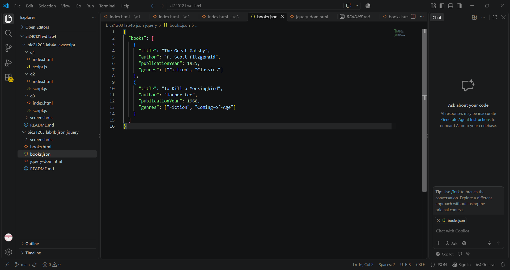
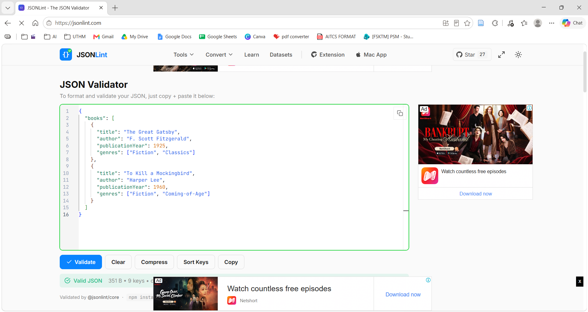
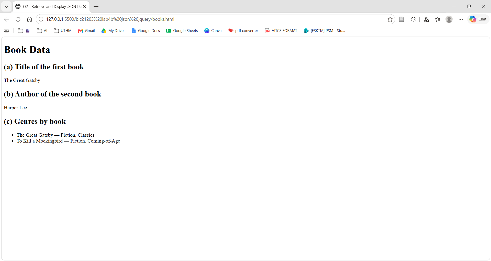
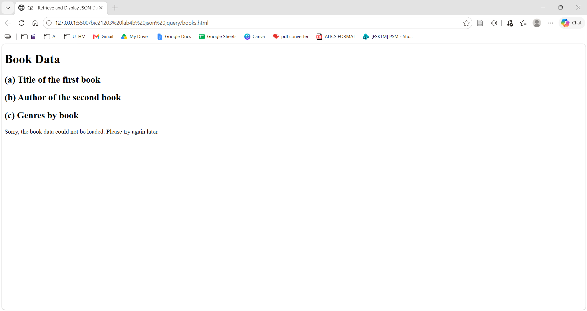
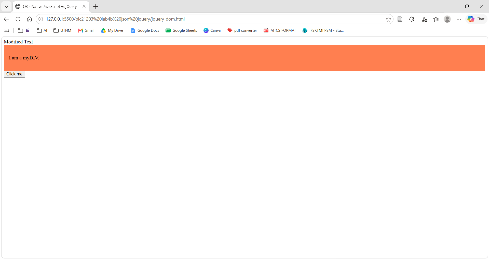
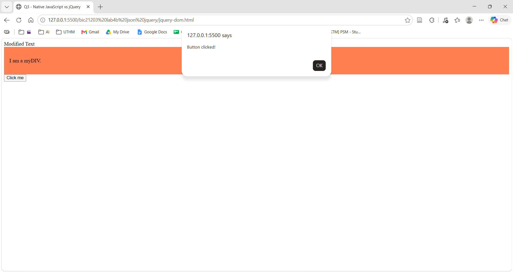

# BIC21203 Lab 4b – JSON and jQuery

**Name:** KYLIE CHOONG KAI LI
**Student ID:** AI240121

## Description
This lab creates a JSON dataset, loads it with `fetch()`, and compares native JavaScript with jQuery.

## How to run
`books.html` must run through a local server, because `fetch()` does not work from `file://`. In VS Code, right-click `books.html` and choose **Open with Live Server**. `jquery-dom.html` can be opened the same way. It needs an internet connection to load jQuery from the CDN.

## Files
- `books.json` – book dataset
- `books.html` – loads and displays the JSON data
- `jquery-dom.html` – jQuery DOM and event operations

## Q1 – JSON Data
`books.json` has a top-level `books` array with two book objects. Each has a string `title` and `author`, a numeric `publicationYear`, and a `genres` array of strings.

**Complete JSON file**

**JSON validation (parses successfully)**

## Q2 – Retrieve and Display JSON Data
`books.html` uses `fetch()` with `async/await` to load `books.json`, then displays the first book's title, the second book's author, and the genres grouped by book title. Errors show a friendly message on the page.

**Successful output**

**Error message (file not found)**

## Q3 – jQuery
`jquery-dom.html` uses jQuery 4.0.0 with `.text()`, `.addClass()` and `.on("click", ...)`.

**Page after load**

**After clicking the button**

